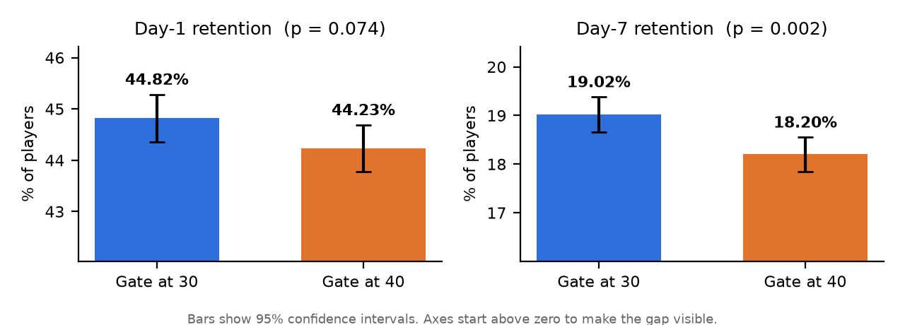

# Cookie Cats A/B Test 🐱

A full analysis of the public **Cookie Cats** mobile-game experiment. 90,189 new players were randomly given the first gate at **level 30** or **level 40**, and we measure whether they came back 1 and 7 days after installing. It's delivered the way a consultant would: a reproducible notebook plus a one-page client summary.

**Deliverables**
- [`summary.pdf`](summary.pdf): the one-page readout for the client.
- [`cookie_cats_analysis.ipynb`](cookie_cats_analysis.ipynb), also as [`.html`](cookie_cats_analysis.html): the executed notebook.



## Findings

| | Gate 30 | Gate 40 | Difference (95% CI) | p |
|---|---|---|---|---|
| Day-1 retention | 44.82% | 44.23% | −0.59 pts [−1.24, +0.06] | 0.074 |
| **Day-7 retention** | **19.02%** | **18.20%** | **−0.82 pts [−1.33, −0.31]** | **0.0016** |

**Recommendation: keep the gate at level 30.** Level 40 loses about **820 players per 100,000 installs** by day 7 (95% CI 312–1,328).

## What the analysis covers

1. **Data check.** 3,994 players never played a round. One account logged 49,854 rounds in 14 days, which is likely a bot; it's excluded from engagement averages.
2. **Was the split clean?** A sample-ratio-mismatch test finds 49.56% / 50.44% instead of 50/50, **χ² = 6.90, p = 0.0086**. Most write-ups of this dataset miss it. It's flagged as a caveat, with the follow-up question for the data team.
3. **Retention tests.** Two-proportion z-tests (pooled SE) with unpooled 95% CIs for day 1 and day 7, plus relative lifts.
4. **Bootstrap.** 10,000 resamples per metric: the day-7 CI is [−1.33, −0.30] pts, and gate 30 wins in 99.9% of resamples. A literal row-resampling check confirms the binomial shortcut.
5. **Peeking simulation on this data** (there are no timestamps, so players arrive in random order over 14 "days"):
   - **A/A permutations:** daily peeking "finds" an effect in **21.8%** of 2,000 tests, against **5.3%** for one planned look.
   - **Replays of the real test:** only 14% of day-1 looks and 61% of day-7 looks are significant, even though the effect is real.
6. **Recommendation and caveats.** The split imbalance, retention not being revenue, and the next experiment to run.

## Run

```
./get_data.sh                                   # downloads and verifies the dataset (SHA-256)
python3 -m venv .venv && .venv/bin/pip install numpy pandas matplotlib nbformat nbclient nbconvert ipykernel
.venv/bin/python make_notebook.py               # builds, executes and exports the notebook
.venv/bin/python make_summary.py                # builds the one-page PDF (all numbers computed, none typed)
.venv/bin/python test_cookie.py                 # 15 checks
```

## Tests (`test_cookie.py`)

- **Data:** it's the real public dataset: 90,189 unique players, the published split and the published retention rates.
- **Statistical tests:**
  - the z-test matches a hand calculation
  - day 7 is significant and day 1 isn't
  - the SRM χ² = 2 × 394.5² / 45,094.5
- **Bootstrap:** its CI equals the normal CI within 0.05 pts, and row resampling has the same spread as the shortcut.
- **Peeking:** A/A with one look holds 5%, daily peeking inflates it to 15–30%, and the replay curves are consistent.
- **Deliverables:** the notebook executed with no errors, the summary quotes the computed numbers, and the PDF is one page.

*Data: Cookie Cats A/B test (Tactile Entertainment), public on Kaggle. It's not redistributed here; `get_data.sh` fetches a verified copy.*
